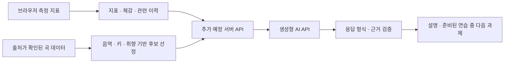

# SING · 나의 작은 보컬 연습실

**보컬 초보자가 집에서도 자신의 목소리에 맞는 연습과 피드백을 받으며, 편안한 발성을 익히고 변화 과정을 확인하도록 돕는 프로젝트입니다.**

현재는 Android 화면을 우선으로 만든 **1단계 모바일 웹 프로토타입**입니다. 짧은 허밍의 음높이와 사용자가 느낀 편안함을 함께 기록하고, 반복해서 편했던 음에서 다음 연습을 시작합니다. 이 기반 위에 AI 피드백, 맞춤 연습 안내, 곡 추천을 단계적으로 개발할 예정입니다.

> 현재 음높이 측정은 브라우저에서 실행되는 일반 음향 분석 알고리즘을 사용합니다. 플레이리스트별 AI 곡 추천은 OpenAI API로 연결되어 있습니다(키 설정과 사용자 동의가 필요합니다). 연습 피드백도 OpenAI가 만듭니다. 측정은 앱이 하고 AI는 앱이 잰 숫자만 받아 설명합니다(녹음과 가사 글자는 보내지 않습니다).

## 프로젝트 정보

| 항목 | 내용 |
| --- | --- |
| 프로젝트명 | SING — 나의 작은 보컬 연습실 |
| 성격 | 인공지능프로젝트 수업의 개별 프로젝트이며, 수업 이후에도 계속 발전시킬 장기 프로젝트 |
| 현재 단계 | 1단계 모바일 웹 프로토타입 (2026년 10월 13일 기준) |
| 사용 환경 | Android 스마트폰 Chrome을 우선으로 설계(실기기 마이크 검증은 진행 전), 노트북 브라우저에서도 사용 가능 |
| 수업 발표 | 2026년 11월 17일 — 장기 프로젝트의 중간 점검 |
| 다음 목표 | 알아두기 칼럼 → 맞춤 연습 안내 → Android 실기기·노래방 검증 |

## 개발 배경과 사용자

노래를 부를 때 고음과 발성이 어렵지만, 보컬 레슨을 받아본 적이 없어 무엇부터 연습해야 할지 모르는 경험에서 출발했습니다. 노래를 부른 뒤 점수만 확인하는 것보다, 오늘 할 수 있는 짧은 연습을 찾고 다음날에도 이어가는 경험을 목표로 합니다.

첫 사용자는 개발자 본인이며, 이후 혼자 기초 보컬 연습을 하려는 초보자로 범위를 넓힐 계획입니다. 주 사용 환경은 집과 스마트폰 내장 마이크입니다. 노트북에서도 사용할 수 있고, 코인노래방에서는 플레이리스트와 기록을 활용하는 흐름을 구상하고 있습니다.

프로젝트가 지향하는 전체 경험은 다음과 같습니다.

**내 목소리 알아가기 → 나에게 맞춰 연습하기 → 불러볼 곡 찾기 → 실제 경험 기록하기 → 다음 연습과 추천에 반영하기**

## 해결하려는 문제와 접근

혼자 연습하는 보컬 초보자에게 부족한 것을 세 가지로 보았습니다.

| 부족한 것 | 혼자 연습할 때의 상황 | SING의 접근 | 상태 |
| --- | --- | --- | --- |
| 기준 | 내가 낸 음이 맞는지, 어디까지 편하게 낼 수 있는지 스스로 판단하기 어렵다 | 허밍의 음높이를 측정해 기준음과 비교하고, 편안함은 본인이 직접 기록한다 | 구현 |
| 해석과 다음 행동 | 녹음이나 측정값을 봐도 무슨 뜻인지, 다음에 무엇을 연습할지 모른다 | 측정 결과와 기록을 근거로 생성형 AI가 쉬운 말로 설명하고 다음에 확인할 점을 제안한다 | 계획 |
| 기록과 적용 | 연습의 변화가 남지 않고, 노래방에서 무엇을 몇 키로 부를지 매번 다시 고민한다 | 연습 기록과 개인 노래장을 남기고 다음 연습 안내와 곡 추천에 반영한다 | 기록·노래장 구현, 추천은 계획 |

**왜 생성형 AI인가:** 음향 분석은 어떤 높이의 음을 냈는지 수치로 알려줄 수 있지만, 초보자에게 더 필요한 것은 그 수치가 무슨 뜻이고 다음에 무엇을 하면 되는지에 대한 설명입니다. 개인 레슨에서 선생님이 해주는 설명과 다음 과제 제안을 사용자의 기록을 근거로 생성형 AI가 돕는 것이 목표입니다. 음높이 측정과 판정은 분석 코드가 맡고, 생성형 AI는 그 결과를 설명하는 역할로 한정합니다.

## 화면 예시

2026년 9월 27~28일에 확인한 화면입니다. 홈은 9월 27일의 초기 화면이라 이후 상단 메뉴에 추가된 ‘뭐 부르지?’가 보이지 않습니다. 개인 노래장은 9월 28일, 곡을 추가하기 전의 빈 화면입니다.

| 오늘의 연습 | 뭐 부르지? |
| --- | --- |
|  |  |

[데스크톱 홈 화면](docs/screenshots/home-desktop.png)도 함께 있습니다.

**첫 레슨 흐름:** 오늘의 목 상태 확인 → 허밍 안내·피아노 기준음 미리듣기 → 편한 높이에서 3초 허밍 → 감지한 음 확인과 편안함 입력 → 같은 음 재확인 → 마무리 또는 반음 높여보기 → 결과 확인 → 두 번 이상 편했던 음에서 짧은 허밍 → 저장·기록. 목이 피곤하거나 불편하다고 고르면 발성 없이 학습·휴식 기록으로 안내합니다. 흐름도는 [화면과 사용자 흐름](docs/ui-flows.md)에 있습니다.

## 현재 구현한 기능 · 1단계

| 기능 | 현재 동작 |
| --- | --- |
| 첫 연습 안내 | 오늘의 목 상태를 확인하고, 입술을 가볍게 맞댄 허밍의 느낌을 안내합니다. |
| 피아노 기준음 | 실제 피아노 녹음으로 기준음을 들려주고, 첫 안내에서 미리 들어볼 수 있습니다. |
| 편한 시작음 탐색 | 3초 허밍에서 음높이를 추정하고 같은 음을 다시 확인합니다. 사용자가 선택하면 반음 높여 탐색합니다. |
| 체감과 측정 구분 | 감지한 음높이와 별도로 편안함·힘듦/갈라짐·모름을 직접 기록합니다. |
| 후속 연습 | 두 번 이상 편하게 확인한 음에서 짧은 허밍을 제안합니다. 불편함을 기록하면 발성을 중단하는 흐름으로 안내합니다. |
| 연습 기록 | 시도별 결과, 중간 초안, 주간 활동을 저장합니다. 지난 확인 음은 다음 회차의 후보로만 사용하고 다시 확인합니다. |
| 학습과 휴식 | 소리를 내지 않은 날에도 학습·휴식 활동을 남길 수 있습니다. |
| 플레이리스트 | ‘뭐 부르지?’에서 이름을 직접 붙인 플레이리스트를 만들고, 곡 하나를 여러 리스트에 담습니다. 모든 곡은 제목·가수로 검색합니다. |
| 곡 찾아 담기 | 노래방처럼 검색해서 곡을 담습니다. TJ미디어 노래방 검색을 먼저 쓰고(가요 기본, 외국 노래 포함 선택, 가수의 곡 전체 보기, ㅐ/ㅔ 오타 다시 찾기), 찾지 못하면 MusicBrainz로 찾습니다. 고른 곡은 TJ 번호와 함께 저장하고 최고음을 자동으로 찾습니다. 못 찾은 곡만 직접 입력합니다. |
| 내 음역 | ‘뭐 부르지?’에 처음 들어오면 자신 있게 부르는 곡을 검색해 고릅니다. 각 곡의 확인된 최고음과 불렀던 키로 ‘편하게 내는 최고음’을 어림해 오선지에 보여주고, 직접 고칠 수도 있습니다. |
| AI 곡 추천 | 곡을 3개 이상 담은 리스트에서, 사용자가 동의하면 OpenAI가 웹에서 확인한 곡 3개와 추천 이유를 보여줍니다. 내 음역이 있으면 리스트 이름의 의도(편하게·도전·상관없음)에 맞춰 곡을 고르고, 곡마다 원키를 가운데에 두고 내게 맞는 노래방 키를 표시합니다. |
| 노래 화면 | 곡 상세 화면에서 원곡과 금영 노래방 영상(멜로디 있는 기본 버전 우선)을 앱 안에서 바로 봅니다. 원곡은 YouTube의 공식 음원 트랙을 먼저 쓰고(곡 길이로 맞춤), 없으면 뮤직비디오로 대신합니다. 음원 트랙은 가사 시간과 그대로 맞아서 시작을 맞추지 않아도 됩니다. 가사 시간 정보로 1절·후렴 전·후렴·간주 같은 구간을 계산해 흐름 막대와 구간 버튼으로 바로 이동합니다. 가사는 노래방 자막형(지금 줄과 다음 줄)과 전체 가사형(가운데 정렬, 줄을 누르면 그 줄로 이동)으로 보여주며 저장하지 않습니다. 신경 쓰이는 곳에는 구간 메모를 남깁니다. TJ 공식 영상은 다른 사이트 안에서 재생이 막혀 있어 TJ 번호와 TJ 채널 안 검색 링크만 둡니다. |
| AI 연습 피드백 | 허밍 연습 결과 화면과 지난 기록에서 ‘AI 피드백 받기’를 누르면 잘한 점·아쉬운 점·추천 연습을 보여주고 그 기록에 함께 저장합니다. 노래 화면에서는 이어폰을 끼고 ‘따라 부르고 피드백 받기’로 곡을 따라 부른 뒤, 가사 줄마다 소리를 낸 비율·가장 높은 음·흔들림·끊김과 두 후렴의 음 차이를 재서 어느 구간의 어느 줄이 좋았고 아쉬웠는지 알려줍니다(‘여기로 가기’로 그 줄로 이동). AI에는 숫자·음 이름·구간 이름·줄 번호만 보냅니다. 어느 줄에 어떤 문제(끊김·흔들림·높음·두 후렴의 높이 차이)가 있는지는 앱이 기준으로 정하고, AI는 그것을 말로 옮기기만 합니다. 서버는 아쉬운 점이 문제가 있는 줄만, 잘한 점이 문제가 없는 줄만 가리키는지 확인하고, 뚜렷한 문제가 없으면 아쉬운 점을 지어내지 않고 비워 둡니다. 따라 부르기 피드백은 화면에만 보여주고 저장하지 않습니다. |
| 데이터 관리 | 선택한 원음 보관, 재생·삭제, 기록·곡·플레이리스트의 백업·복원을 지원합니다. |

곡은 **제목만으로 저장**할 수 있습니다. 원곡 키, 원곡 진성·가성 최고음과 최저음, 내 노래방 키(반음 단위), 부르는 옥타브, HTTPS 가사 링크, 메모는 선택 입력입니다. 최고음을 입력하면 내 키로 부르는 최고음도 표시합니다.

플레이리스트 이름은 사용자가 정합니다. 예전 분류(`불러볼 곡 / 연습 중 / 익숙한 곡`)에 담긴 곡은 처음 열 때 같은 이름의 플레이리스트로 옮겨집니다.

AI 추천과 곡 검색은 처음 한 번 무엇을 보내는지 보여주고 동의를 받습니다. OpenAI에는 리스트 이름과 담긴 곡의 제목·가수·키·최고음, 이미 담은 곡 목록, 내 편한 최고음(알려준 경우)만 보냅니다. 곡 검색어는 TJ미디어 노래방 검색으로 보내고, 찾지 못하면 공개 음악 데이터베이스인 MusicBrainz로 보냅니다. TJ는 공개 API가 없어 사용자가 검색할 때만 검색 페이지를 한 번 조회하고, 결과를 모아 저장하지 않습니다. 곡 상세 화면을 열면 곡 제목과 가수가 YouTube 검색(영상 찾기)과 가사 시간 정보 서비스(LRCLIB, 구간 계산)로 갑니다. 가사는 서버가 받아 곡 화면으로 전달만 하고, 화면에만 보여줍니다. 기기 저장소·백업·서버·저장소(repo) 어디에도 저장하지 않습니다. 녹음은 어디에도 보내지 않고, 연습 측정값은 동의한 사용자가 피드백을 요청할 때만 보냅니다.

곡의 최고음은 AI가 웹에서 찾고, **로컬 서버가 다시 확인**합니다. AI가 인용한 문장이 출처 페이지에 실제로 있는지, 그 문장 속 음 표기(한국식 "2옥타브 라", 국제 표기 "A4", 일본식 "hiA")를 코드가 직접 읽어 AI가 바꾼 음과 같은지 대조하고, 통과한 값에만 ✓를 붙입니다. 화면에는 출처 사이트 이름을 표시하지 않습니다. 실제로 있는 곡임을 보여주는 https 출처가 없는 후보는 버립니다. 허밍 기록만으로 곡의 난이도나 적합성을 판정하지 않습니다.

## 다음 개발 단계와 AI 활용 계획

아래 내용은 **개발 예정 또는 검토 중인 기능**입니다. 현재 제공하는 기능과 구분합니다.

| 단계 | 개발 내용 | AI의 역할과 선행 작업 |
| --- | --- | --- |
| 다음 단계 | 개인 맞춤 연습 안내 | 기록·목표·가능한 시간을 참고해 준비된 연습 콘텐츠에서 다음 과제를 선택하고 이유를 설명합니다. |
| 장기 확장 | 변화 요약과 구절 연습 | 같은 과제의 이전 녹음 비교, 주간 변화 요약, 어려운 구절을 나눠 연습하는 기능을 검토합니다. |
| 발표 이후·검토 | 노래방 녹음 분석 | 노래방에서 녹음한 파일(반주가 섞인 소리)을 분석하는 방법을 검토합니다. 지금의 음높이 추정은 반주에 끌려가 프레임의 4~32%만 잡았고, 녹음을 직접 듣는 AI는 시간과 가사를 지어내서 쓰지 않았습니다(2026-11-06 확인). |
| 발표 이후·검토 | 감정 힐링 리포트 | 노래에 묻어나는 감정을 짚어 주는 리포트(교수님 제안)를 기록해 두고 검토합니다. |

### 측정과 설명의 역할 구분

분석 대상은 악센트나 음색이 아니라 **음정 정확도**(목표음과 맞는지)와 **음높이 유지 안정성**(음을 유지하는 동안 음높이가 얼마나 변하는지)입니다. 수치는 분석 코드가 계산하고, 생성형 AI는 그 결과를 근거로 설명과 제안을 만드는 구조를 목표로 합니다.

| 구분 | 맡는 일 | 맡지 않는 일 | 현재 상태 |
| --- | --- | --- | --- |
| 일반 음향 분석 (`src/pitch.js`) | 음높이 추정, 측정 신뢰도 판정, 기준음 일치 여부 판단. 다음 단계에서 음정 정확도·음높이 유지 안정성 지표 계산 | 음색 평가, 발성 원인 진단 | 사용 중 · 브라우저 안에서 실행 |
| 분석용 AI 모델 (학습 기반 음높이 추정) | 실제 마이크·소음 환경에서 음높이 추정 보완 | 설명 문장 생성 | 도입 여부 미정 · 기존 방식과 실제 녹음을 비교한 뒤 결정 |
| 생성형 AI (LLM) | 지표·체감·이력을 근거로 한 설명, 다음 과제 선택 이유와 추천 이유 작성 | 측정값·점수·곡 정보 생성, 의학적 판단 | 곡 추천·최고음 찾기·연습 피드백에 사용 중(OpenAI Responses API, 로컬 서버). 연습 피드백은 웹 검색 없이 JSON 형식으로만 답하게 합니다 |

현재는 목표음과의 차이(±50센트)와 음높이 변화 허용 범위를, 해당 시도를 ‘확인한 음’으로 인정할지 판정하는 데만 사용합니다. 사용자가 볼 수 있는 지표나 시간별 음높이 그래프는 아직 제공하지 않습니다.

**연결 원칙 (계획)**

- API 키는 추가할 서버에서 관리하고 브라우저 코드에 넣지 않습니다.
- 초기 AI 입력은 원음보다 측정 지표, 사용자 체감, 필요한 이력을 중심으로 설계합니다. 외부로 보내는 항목과 목적은 연결 전에 화면에서 안내합니다.
- 신뢰도가 낮은 측정은 근거로 쓰지 않고, 응답에 입력에 없는 수치·점수·곡 정보가 생기지 않도록 검증합니다.
- AI 연결이 실패해도 측정 사실에 기반한 기본 안내와 기록 저장은 그대로 동작하게 합니다.

상세 내용은 [AI 활용 계획](docs/ai-plan.md)과 [개발 로드맵](docs/roadmap.md)을 참고하세요.

## 시스템 구조

현재 앱은 외부 프레임워크와 설치 의존성이 없는 HTML·CSS·JavaScript ES Modules로 구성되어 있습니다. Node.js 서버는 앱 파일을 제공하는 개발 서버이며, AI 추천·최고음 찾기·곡 검색 요청을 대신 전달하고 결과를 확인합니다. 음성 처리용 백엔드는 없습니다.

### 현재 구조 (구현됨)

```mermaid
flowchart TD
    Static[Node.js 정적 개발 서버] --> UI[브라우저 화면 · app / views]
    User[사용자] -->|허밍 · 체감 입력| UI
    UI -->|기준음 재생| Piano[Web Audio · 로컬 피아노 샘플]
    UI --> Capture[마이크 입력 · 짧은 녹음]
    Capture --> Pitch[pitch.js · 음높이와 신뢰도 추정]
    Pitch --> Lesson[lesson.js · 진행 규칙]
    UI -->|편안함 응답| Lesson
    Lesson -->|결과 · 다음 과제| UI
    UI <--> Songs[플레이리스트 · 곡 입력 / 검색 / 키 기록]
    UI <--> SongScreen[노래 화면 · 원곡(음원/MV) · 금영 노래방 · 구간 · 가사 · 구간 메모]
    SongScreen -->|재생| YTPlayer[YouTube 플레이어 · nocookie]
    UI <--> Store[storage.js · IndexedDB]
    Store <--> Backup[사용자 백업 파일]
    UI -->|동의 후, 버튼을 누를 때만| Server[로컬 서버]
    SongScreen -->|이어폰 · 따라 부르기 · 50ms마다 음높이| SingAlong[sing-along.js · 가사 줄별 숫자]
    Server -->|/api/practice-feedback · 숫자와 줄 번호만 · 웹 검색 없음| OpenAIFb[OpenAI · 연습 피드백]
    OpenAIFb -->|짧은 항목 · 받은 줄만 가리키는지 확인| UI
    Server -->|/api/recommend · /api/song-range| OpenAI[OpenAI · 웹 검색]
    OpenAI --> Verify[인용 · 음 표기 확인]
    Verify -->|내 음역으로 분류한 추천 카드 · 곡 최고음| UI
    Server -->|/api/song-search · 1초에 1번| TJ[TJ 노래방 검색 · ㅐ/ㅔ 다시 찾기]
    TJ -->|없으면| MB[MusicBrainz]
    TJ -->|곡 검색 결과 · 노래방 번호| UI
    MB -->|곡 검색 결과| UI
    Server -->|/api/song-videos · 쪽마다 30일에 한 번| YT[YouTube Data API]
    YT -->|원곡(음원 트랙, 없으면 MV) · 금영 노래방 영상 후보| SongScreen
    Server -->|/api/song-sections · 곡 화면을 열 때 · 가사는 앱을 켠 동안 한 번| LRC[LRCLIB 가사 시간]
    LRC -->|구간 · 가사 줄(화면에만, 저장 안 함)| SongScreen
```

| 기술·모듈 | 역할 |
| --- | --- |
| Web Audio API / MediaRecorder | 피아노 재생, 마이크 입력, 짧은 녹음 |
| `src/pitch.js` | 단일 음의 주기성을 이용한 음높이 추정과 측정 신뢰도 확인 |
| `src/audio.js`, `src/capture.js`, `src/piano.js` | 녹음·재생·취소 동작과 피아노 샘플 관리 |
| `src/lesson.js` | 같은 음 재확인, 체감에 따른 진행·중단, 후속 연습 규칙 |
| `src/songs.js`, `src/song-views.js` | 곡 데이터 검증·검색과 곡 입력·상세 화면 |
| `src/playlists.js`, `src/playlist-views.js` | 플레이리스트 규칙(이름·소속·추천 보관)과 화면 |
| `src/recommend.js` | 추천 요청 구성, AI 후보 정리(출처·중복), 노래방 키 어림 계산 |
| `src/notes.js`, `src/vocal-range.js` | 음 표기 읽기(한국식·국제·일본식), 내 편한 최고음 계산, 편함·도전·무리 분류 |
| `src/onboarding.js`, `src/onboarding-views.js`, `src/range-graphics.js` | 내 음역 온보딩, 오선지와 노래방 키 줄 |
| `src/sections.js` | 가사 줄의 시간과 반복만으로 구간(1절·후렴 전·후렴·간주·마무리) 계산 |
| `src/song-media.js`, `src/song-media-views.js`, `src/song-player.js` | 곡의 영상·구간·시작 차이·구간 메모 데이터와 30일/7일 규칙, 노래 화면, YouTube 플레이어 연결 |
| `src/practice-feedback.js`, `src/sing-along.js` | 허밍·따라 부르기 측정값을 AI에 보낼 숫자로 정리(가사 글자 제외), 줄별 지표와 두 후렴 비교, AI 답 검사, 따라 부르기 중 50ms마다 음높이 재기 |
| `src/consent.js` | AI·곡 검색·영상 찾기 동의 버전 관리 |
| `src/storage.js` / IndexedDB | 연습·곡·선택한 원음 저장, 백업·복원 |
| `src/app.js`, `src/views.js`, `src/styles.css` | 화면 전환, 입력 처리, 모바일 중심 UI |
| `scripts/serve.mjs`, `scripts/server.mjs` | 로컬 개발 서버와 추천 API(입력 한도, 키는 `.env`) |
| `scripts/ai.mjs`, `scripts/services.mjs` | OpenAI Responses API 호출과 추천·최고음 찾기 흐름 |
| `scripts/verify-source.mjs` | 출처 페이지의 인용 문장·음 표기 확인, 내부망 접속 차단 |
| `scripts/tj.mjs`, `scripts/song-search.mjs`, `scripts/throttle.mjs` | TJ 노래방 검색 결과 읽기·정렬, TJ 우선·MusicBrainz 대체 검색 흐름, 외부 요청 간격(1초)과 밀린 검색 버림 |
| `scripts/musicbrainz.mjs` | MusicBrainz 곡 검색(TJ가 찾지 못할 때) |
| `scripts/youtube.mjs`, `scripts/lrclib.mjs`, `scripts/title-match.mjs` | YouTube Data API로 MV·금영 노래방 영상 후보 찾기, LRCLIB 가사 시간으로 구간 계산(글자는 응답에 넣지 않음), 괄호가 붙은 TJ식 제목 맞추기 |
| `scripts/check-ai.mjs`, `scripts/check-range.mjs`, `scripts/check-search.mjs` | 실제 키로 추천과 10곡 최고음 확인 점검, 실제 TJ 검색 점검 |
| Node.js 내장 테스트 / 브라우저 검사 페이지 | 음향 계산·레슨 규칙·저장·재생 동작 검증 |

측정값과 사용자 체감은 서로 다른 정보로 다룹니다. 현재 결과는 해당 시도에서 확인한 음이며, 사용자의 전체 음역이나 발성 상태를 확정하는 진단 결과가 아닙니다.

### 확장 구조 (계획 · 아직 구현되지 않음)



생성형 AI는 브라우저에서 직접 호출하지 않고, 추가할 서버 API를 거쳐 API 키를 보호하는 구조로 계획하고 있습니다. 서버·모델·곡 데이터 공급원은 아직 정하지 않았습니다.

[시스템 구조 문서](docs/architecture.md) · [화면과 사용 흐름](docs/ui-flows.md)

## 진행 상황과 개발 일정

2026년 11월 4일 현재 상태를 기준으로 정리했습니다. 아래 일정은 10월 13일에 세운 **제안 일정**입니다. 지난 계획의 날짜가 지났다는 이유로 완료 처리하지 않고, 구현·검증 증거가 있는 항목만 완료로 봅니다.

| 구분 | 11월 4일 기준 상태 |
| --- | --- |
| 1단계 모바일 웹 | 구현 — 첫 안내, 편한 시작음 탐색, 짧은 연습, 로컬 기록 |
| 플레이리스트·곡 검색·내 음역 | 구현 — TJ 우선 곡 검색, AI 곡 추천, 내 편한 최고음과 노래방 키 줄 |
| 노래 화면 | 구현 — 원곡(공식 음원 트랙 우선, 없으면 MV)·금영 노래방 영상, 자동 구간, 가사 보기(자막형·전체형), 시작 맞추기, 구간 메모. 영상 자동 찾기는 YouTube Data API 키가 있을 때 동작 |
| 공개 저장소와 문서 | 10월 13일 공개 |
| Android 실기기 마이크 검증 | 완료 증거 없음 — 다음 단계의 우선 검증 대상 |
| 음정 정확도·음높이 유지 안정성 지표 | 연습 피드백 안에서 사용 — 목표음과의 차이(센트), 가사 줄별 흔들림·끊김·소리 낸 비율. 화면에 따로 보여주는 지표·그래프는 아직 없음 |
| 생성형 AI 연결 | 곡 추천·최고음 찾기·연습 피드백(허밍 결과, 노래 따라 부르기)에 사용 중(OpenAI) |

| 기간 (제안) | 우선 작업 | 완료 기준 / 산출물 |
| --- | --- | --- |
| 10/13~10/19 | 공개 저장소·문서 정리, Android 마이크·기준음·취소·저장 확인, 음정 정확도·음높이 유지 안정성 지표 정의 | README·구조도·화면 예시, 기기별 확인 기록, AI 입력 항목 초안 |
| 10/20~10/26 | 측정 지표 화면, 생성형 AI 피드백의 최소 흐름 | 검증 가능한 지표, 서버 API, 결과 설명, 실패 시 기본 안내 |
| 10/27~11/2 | 준비된 연습 목록과 맞춤 안내, 노래장 분류 개선, 곡 데이터 확보 가능성 확인 | 연습 선택 조건, 사용자 분류, 출처 있는 곡 데이터 소규모 검토 |
| 11/3~11/9 | 통합 검증, 오류 처리·기록 보존 확인, 발표 버전 범위 확정 | 재현 가능한 핵심 시나리오, 수정 내역, 발표 버전 |
| 11/10~11/16 | 발표 자료, 30초 시연 영상, 리허설 | 5분 발표 자료와 시연 영상, 실제 동작과 계획 구분 |
| 11/17 | 수업 발표 (중간 점검) | 피드백 수집, 후속 개발 항목 정리 |

측정이 불안정하면 Android 검증과 지표 보완을 먼저 진행하고, AI 기능은 한 음 연습의 근거 있는 결과 설명부터 완성합니다. 발표 이후에도 실제 연습 기록을 바탕으로 맞춤 연습과 곡 추천을 확장하고, 같은 과제의 전후 녹음 비교와 주간 변화 요약을 검토합니다. 자세한 내용은 [개발 로드맵](docs/roadmap.md)에 있습니다.

## 로컬 실행

Node.js **22 이상**이 필요합니다. 외부 패키지가 없어 `npm install` 과정은 필요하지 않습니다.

```powershell
git clone https://github.com/Yoonsung-kor/SING.git
cd SING
npm start
```

브라우저에서 [http://127.0.0.1:4173](http://127.0.0.1:4173)을 엽니다. 이 주소는 실행한 컴퓨터에서만 접근하는 로컬 주소입니다. 서버 종료는 해당 터미널에서 `Ctrl+C`이며, `PORT` 환경 변수로 포트를 바꿀 수 있습니다.

**마이크 없이 둘러보기**는 예시 측정값으로 화면 흐름을 확인하는 체험 모드입니다. 체험 중의 완료·활동 기록과 플레이리스트는 실제 저장소에 쓰지 않으며, 종료하거나 새로고침하면 사라집니다. 실제 음성을 분석한 결과가 아닙니다. 피아노 미리듣기는 실제 기준음을 재생합니다.

### AI 추천 켜기

플레이리스트의 AI 곡 추천은 OpenAI API를 사용합니다. 키는 이 컴퓨터의 서버에만 두고 브라우저로 보내지 않습니다.

1. `.env.example`을 복사해 `.env`를 만들고 `OPENAI_API_KEY`에 키를 넣습니다. `OPENAI_MODEL`은 사용할 모델입니다.
2. `node scripts/check-ai.mjs`로 키와 모델이 웹 검색과 함께 동작하는지 먼저 확인합니다.
3. `npm start`를 실행하면 시작 메시지에 `AI 추천: 켜짐`이 표시됩니다.

노래 화면의 영상 자동 찾기는 YouTube Data API v3 키를 씁니다. Google Cloud 프로젝트에서 YouTube Data API v3를 켜고 만든 키를 `.env`의 `YOUTUBE_API_KEY`에 넣으면 시작 메시지에 `영상 찾기: 켜짐`이 표시됩니다. 키가 없으면 링크 붙여넣기만 됩니다. 검색 1번에 100단위, 영상 길이 확인에 1단위를 쓰고 기본 할당량은 하루 10,000단위입니다. 새 곡 하나에 200~400단위(원곡 음원 검색, 확인용 MV 검색, 노래방 검색)를 써서 하루에 새 곡 25~50곡쯤 찾을 수 있습니다. 한 번 찾은 영상은 30일 동안 다시 찾지 않습니다. 할당량을 넘거나 잠시 막히면 화면에서 링크 붙여넣기와 다시 열기를 안내합니다.

`.env`는 `.gitignore`에 포함되어 커밋되지 않습니다. 키가 없으면 앱은 그대로 동작하고, 추천과 최고음 찾기만 "아직 AI가 설정되지 않았어요."로 안내합니다. 곡 검색(MusicBrainz)은 키가 없어도 동작합니다. `node scripts/check-range.mjs`로 10곡의 최고음 찾기와 확인 결과를 점검할 수 있습니다(AI 호출 약 10번).

> **주의:** 서버는 기본적으로 `127.0.0.1`에서만 열립니다. `HOST` 환경 변수로 LAN 주소에 열면 같은 네트워크의 누구나 이 서버를 통해 키를 사용할 수 있습니다. 휴대폰은 `adb reverse`로 연결하세요.

### Android에서 확인하기

휴대폰 마이크 접근에는 HTTPS 또는 휴대폰의 `localhost` 같은 보안 컨텍스트와 사용자의 마이크 권한이 필요합니다. PC의 `localhost` 주소를 휴대폰에 입력하거나 일반 `http://192.168...` LAN 주소를 여는 것만으로는 마이크를 검증할 수 없습니다.

Android 개발 도구와 USB 디버깅을 사용하는 환경에서는 PC의 서버를 켜고, USB로 연결한 기기를 대상으로 다음 명령을 실행할 수 있습니다.

```powershell
adb reverse tcp:4173 tcp:4173
```

이후 **휴대폰 Chrome에서 `http://localhost:4173`**을 엽니다. 자세한 연결 방법은 [Chrome 공식 포트 전달 안내](https://developer.chrome.com/docs/devtools/remote-debugging/local-server)를 참고하세요. 현재 공개 HTTPS 배포와 Android 앱 패키징은 진행하지 않았습니다.

PC의 `127.0.0.1`, PC의 `localhost`, 휴대폰의 `localhost`는 저장소가 서로 다릅니다. 데이터를 옮길 때는 ‘나의 기록 → 기록과 개인정보 관리’의 백업 기능을 사용하세요.

## 데이터 저장과 개인정보

- 음높이 추정은 사용자의 브라우저 안에서 실행됩니다.
- 연습 기록, 곡, 플레이리스트는 해당 기기·브라우저의 IndexedDB에 저장됩니다. 로그인과 기기 간 동기화는 없습니다.
- 원음 보관은 기본적으로 꺼져 있으며, 사용자가 선택한 경우에만 IndexedDB에 저장합니다.
- 녹음을 서버로 전송하는 코드나 분석 SDK는 없습니다. 연습 피드백을 받을 때만, 동의한 경우 연습 측정값(목표음, 낸 음, 흔들림, 체감과 가사 줄 번호별 숫자)을 로컬 서버를 거쳐 OpenAI로 보냅니다. 가사 글자는 보내지 않습니다. AI 추천이나 최고음 찾기를 요청하면 동의한 범위(리스트 이름, 곡 제목·가수·키·최고음·최저음, 이미 담은 곡과 ‘별로예요’를 누른 곡, 내 편한 최고음)만 로컬 서버를 거쳐 OpenAI로 보내고, 곡 검색어는 TJ미디어 노래방 검색(안 되면 MusicBrainz)으로 보냅니다. 내 편한 최고음과 온보딩에서 고른 곡은 이 기기에만 저장합니다. 동의는 ‘나의 기록 → 기록과 개인정보 관리’에서 철회할 수 있습니다. 곡 상세 화면을 열면 곡 제목과 가수가 YouTube 검색과 가사 시간 정보 서비스로 가고, 영상은 YouTube(nocookie) 플레이어로 재생합니다. 외부 참고 링크와 가사 링크를 누르면 별도 사이트를 엽니다.
- 백업 파일에는 보관한 원음과 개인 메모가 포함될 수 있습니다. 브라우저 데이터가 삭제된 경우 저장한 백업으로 복원할 수 있습니다.
- 백업은 최대 25 MB, 개별 원음은 최대 10 MB, 레슨·활동·곡은 각각 500개까지 지원합니다. 저장 실패는 화면에 표시합니다.

연습 피드백 같은 다른 AI 기능을 연결할 때도 전송할 데이터 범위와 동의 안내를 기능별로 따로 설계합니다.

## 검증 방법과 확인 범위

```powershell
npm test
npm run check
```

`npm test`는 음높이 계산, 레슨 진행·종료 규칙, 녹음 취소, 활동 기록, 곡 입력·검색, 백업 검증 등을 검사합니다. `npm run check`는 핵심 앱 파일의 JavaScript 구문을 확인합니다.

서버를 실행한 상태에서 브라우저 검사 페이지도 열 수 있습니다.

| 검사 페이지 | 확인 내용 |
| --- | --- |
| [저장소 검사](http://127.0.0.1:4173/tests/browser.html) | 실제 IndexedDB 저장, 곡·레슨·원음 백업 왕복, 구형 백업 호환과 불량 입력 거절 |
| [피아노 검사](http://127.0.0.1:4173/tests/browser-piano.html) | 동봉 MP3 디코딩, MIME, 길이, 오프라인 렌더링의 음높이 |
| [초기화 검사](http://127.0.0.1:4173/tests/browser-loading.html) | 느린 초기 로딩 중 체험 모드 진입·종료 시 실제 곡과 레슨 초안 보존 |

저장소 관련 브라우저 검사는 고유 이름의 임시 DB에서 실행하고 정리합니다. 정상 연습 DB에는 접근하지 않습니다. 피아노 검사는 마이크를 사용하지 않습니다.

**2026년 9월 28일 검증 기록:** Node 테스트 67개와 브라우저 검사 26개(저장소 11개·피아노 12개·초기화 3개)가 통과했습니다. 체험 모드의 주요 흐름과 모바일·데스크톱 화면도 확인했습니다. 이는 해당 시점의 소프트웨어 동작 검증이며, 실제 사용자의 보컬 분석 정확도나 발성 개선 효과를 입증한 결과는 아닙니다.

**2026년 10월 13일 재확인:** `npm test` 67개 통과, `npm run check` 통과. 이날은 공개 문서와 저장소 준비를 진행했으며 브라우저 검사 26개를 다시 실행하지는 않았습니다.

**2026년 11월 4일 검증 기록 (노래 화면):** `npm test` 257개 통과, `npm run check` 통과. 크롬(헤드리스, 360px, 실제 CSP)에서 링크 붙여넣기 재생, 구간 9개 표시와 이동, 시작 맞추기, 화면을 다시 그려도 같은 플레이어가 재생을 이어감, 막힌 TJ 영상 거절, 자동 찾기(가짜 검색기로 막힌 첫 후보 건너뛰기·다시 열 때 검색 없음·늦은 응답 분리), CSP 위반 없음, 가로 스크롤 없음을 확인했습니다. 실제 YouTube 검색은 키가 생긴 뒤 확인합니다.

## 현재의 한계와 남은 검증

- 노래 화면: TJ 공식 영상은 다른 사이트 안에서 재생이 막혀 있습니다(오류 150). 구간은 가사 시간 정보가 있는 곡(약 60%)에서만 나오고, LRCLIB가 바쁘면 "다시 시도"로 안내합니다. 시작 맞추기는 처음 한 번의 차이만 고치므로, 중간에 다른 장면이 끼어 있는 MV에서는 뒤쪽 구간이 밀릴 수 있습니다.

- 실제 Android 기기의 허밍·주변 소음·마이크 특성에 대한 정확도는 아직 검증하지 않았습니다. 코인노래방의 반주와 다른 목소리를 분리하지 않습니다.
- 사람의 허밍 시범 영상·음원은 아직 포함하지 않았습니다. 간단한 안내와 피아노 기준음으로 구성되어 있습니다.
- 발성 문제의 원인, 성종, 전체 음역의 한계, 고음 개선 효과를 판정하지 않습니다. 음정이 안정적이라는 결과와 편안한 발성은 같은 의미가 아닙니다.
- 3초 녹음, 최대 8회 탐색, 2회 재시도와 측정 임계값은 초기 제품 설정입니다. 실제 사용 결과로 검토·조정해야 합니다.
- 다중 탭·여러 기기의 실시간 병합과 오프라인 설치형 PWA를 지원하지 않습니다. 현재는 한 기기에서 한 탭으로 사용합니다.
- 원음을 먼저 저장한 뒤 레슨 저장이 실패하는 경우, 연결되지 않은 원음이 남을 가능성이 있어 저장소 개선 과제로 남아 있습니다.

## 피아노 음원과 출처

기준음은 **Alexander Holm의 Salamander Grand Piano** 녹음입니다. Yamaha C5의 샘플 17개(C2~C6)를 동봉했으며, 가까운 녹음에서 최대 1반음 조정해 재생합니다. 기본 기준음은 약 1.6초 동안 재생하고 부드럽게 끝나며, 다른 화면으로 이동하면 멈춥니다. 앱 재생 중 외부 음원 서버에 접속하지 않습니다.

- 원본 파일 출처: [Tone.js Salamander 오디오 저장소](https://github.com/Tonejs/audio/tree/master/salamander)
- 저작자 자료: [Alexander Holm — Salamander Grand Piano](https://rytmenpinne.wordpress.com/sounds-and-such/salamander-grandpiano/)
- 배포 출처의 CC BY 3.0 표기와 저작자의 공개 선언, 앱 재생 시 변경 사항: [음원 크레딧](assets/piano-credits.txt)

피아노는 음높이를 알려주는 기준음이며, 사람의 허밍 시범을 대신하는 녹음은 아닙니다.

## 프로젝트 문서

- [시스템 구조](docs/architecture.md)
- [화면과 사용자 흐름](docs/ui-flows.md)
- [AI 활용 계획](docs/ai-plan.md)
- [개발 로드맵](docs/roadmap.md)
