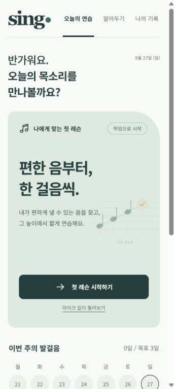
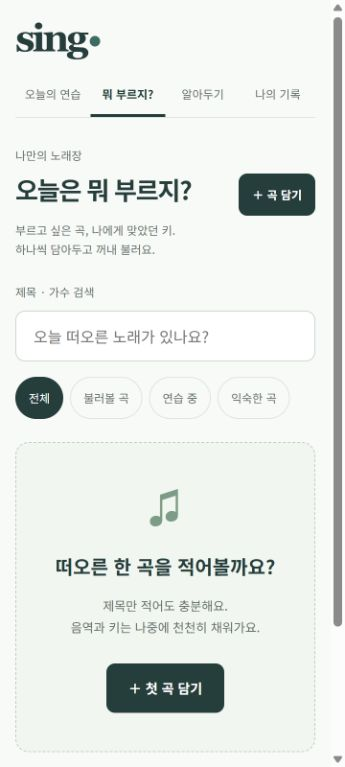

# SING · 나의 작은 보컬 연습실

**보컬 초보자가 집에서도 자신의 목소리에 맞는 연습과 피드백을 받으며, 편안한 발성을 익히고 변화 과정을 확인하도록 돕는 프로젝트입니다.**

현재는 Android 화면을 우선으로 만든 **1단계 모바일 웹 프로토타입**입니다. 짧은 허밍의 음높이와 사용자가 느낀 편안함을 함께 기록하고, 반복해서 편했던 음에서 다음 연습을 시작합니다. 이 기반 위에 AI 피드백, 맞춤 연습 안내, 곡 추천을 단계적으로 개발할 예정입니다.

> 현재 음높이 측정은 브라우저에서 실행되는 일반 음향 분석 알고리즘을 사용합니다. 플레이리스트별 AI 곡 추천은 OpenAI API로 연결되어 있습니다(키 설정과 사용자 동의가 필요합니다). 연습 결과에 대한 생성형 AI 피드백은 아직 구현하지 않았습니다.

## 개발 배경과 사용자

노래를 부를 때 고음과 발성이 어렵지만, 보컬 레슨을 받아본 적이 없어 무엇부터 연습해야 할지 모르는 경험에서 출발했습니다. 노래를 부른 뒤 점수만 확인하는 것보다, 오늘 할 수 있는 짧은 연습을 찾고 다음날에도 이어가는 경험을 목표로 합니다.

첫 사용자는 개발자 본인이며, 이후 혼자 기초 보컬 연습을 하려는 초보자로 범위를 넓힐 계획입니다. 주 사용 환경은 집과 스마트폰 내장 마이크입니다. 노트북에서도 사용할 수 있고, 코인노래방에서는 플레이리스트와 기록을 활용하는 흐름을 구상하고 있습니다.

프로젝트가 지향하는 전체 경험은 다음과 같습니다.

**내 목소리 알아가기 → 나에게 맞춰 연습하기 → 불러볼 곡 찾기 → 실제 경험 기록하기 → 다음 연습과 추천에 반영하기**

## 화면 예시

2026년 9월 27~28일에 확인한 화면입니다. 개인 노래장은 곡을 추가하기 전의 빈 화면입니다.

| 오늘의 연습 | 뭐 부르지? |
| --- | --- |
|  |  |

## 현재 구현한 기능 · 1단계

| 기능 | 현재 동작 |
| --- | --- |
| 첫 연습 안내 | 오늘의 목 상태를 확인하고, 입술을 가볍게 맞댄 허밍의 느낌을 안내합니다. |
| 피아노 기준음 | 실제 피아노 녹음으로 기준음을 들려주고, 첫 안내에서 미리 들어볼 수 있습니다. |
| 편한 시작음 탐색 | 3초 허밍에서 음높이를 추정하고 같은 음을 다시 확인합니다. 사용자가 선택하면 반음 높여 탐색합니다. |
| 체감과 측정 구분 | 감지한 음높이와 별도로 편안함·힘듦/갈라짐·모름을 직접 기록합니다. |
| 후속 연습 | 두 번 이상 편하게 확인한 음에서 짧은 허밍을 제안합니다. 불편함을 기록하면 발성을 중단하는 흐름으로 안내합니다. |
| 연습 기록 | 시도별 결과, 중간 초안, 주간 활동을 저장합니다. 지난 확인 음은 다음 회차의 후보로만 사용하고 다시 확인합니다. |
| 학습과 휴식 | 소리를 내지 않은 날에도 학습·휴식 활동을 남길 수 있습니다. |
| 플레이리스트 | ‘뭐 부르지?’에서 이름을 직접 붙인 플레이리스트를 만들고, 곡 하나를 여러 리스트에 담습니다. 모든 곡은 제목·가수로 검색합니다. |
| 내 음역 | ‘뭐 부르지?’에 처음 들어오면 자신 있게 부르는 곡을 검색해 고릅니다. 각 곡의 확인된 최고음과 불렀던 키로 ‘편하게 내는 최고음’을 어림해 오선지에 보여주고, 직접 고칠 수도 있습니다. |
| AI 곡 추천 | 곡을 3개 이상 담은 리스트에서, 사용자가 동의하면 OpenAI가 웹에서 확인한 곡 3개와 추천 이유를 보여줍니다. 내 음역이 있으면 리스트 이름의 의도(편하게·도전·상관없음)에 맞춰 곡을 고르고, 곡마다 편함·도전·무리 막대를 보여줍니다. |
| 데이터 관리 | 선택한 원음 보관, 재생·삭제, 기록·곡·플레이리스트의 백업·복원을 지원합니다. |

곡은 **제목만으로 저장**할 수 있습니다. 원곡 키, 원곡 진성·가성 최고음과 최저음, 내 노래방 키(반음 단위), 부르는 옥타브, HTTPS 가사 링크, 메모는 선택 입력입니다. 최고음을 입력하면 내 키로 부르는 최고음도 표시합니다.

플레이리스트 이름은 사용자가 정합니다. 예전 분류(`불러볼 곡 / 연습 중 / 익숙한 곡`)에 담긴 곡은 처음 열 때 같은 이름의 플레이리스트로 옮겨집니다.

AI 추천과 곡 검색은 처음 한 번 무엇을 보내는지 보여주고 동의를 받습니다. OpenAI에는 리스트 이름과 담긴 곡의 제목·가수·키·최고음, 이미 담은 곡 목록, 내 편한 최고음(알려준 경우)만 보내고, 곡 검색어는 공개 음악 데이터베이스인 MusicBrainz로 보냅니다. 녹음·허밍·연습 기록은 보내지 않습니다.

곡의 최고음은 AI가 웹에서 찾고, **로컬 서버가 다시 확인**합니다. AI가 인용한 문장이 출처 페이지에 실제로 있는지, 그 문장 속 음 표기(한국식 "2옥타브 라", 국제 표기 "A4", 일본식 "hiA")를 코드가 직접 읽어 AI가 바꾼 음과 같은지 대조하고, 통과한 값에만 ✓를 붙입니다. 화면에는 출처 사이트 이름을 표시하지 않습니다. 실제로 있는 곡임을 보여주는 https 출처가 없는 후보는 버립니다. 허밍 기록만으로 곡의 난이도나 적합성을 판정하지 않습니다.

## 다음 개발 단계와 AI 활용 계획

아래 내용은 **개발 예정 또는 검토 중인 기능**입니다. 현재 제공하는 기능과 구분합니다.

| 단계 | 개발 내용 | AI의 역할과 선행 작업 |
| --- | --- | --- |
| 다음 단계 | 연습 결과를 근거로 한 AI 피드백 | 목표음과의 차이, 유지 시간, 시간에 따른 음높이 변화, 측정 신뢰도와 사용자 체감을 정리한 뒤 생성형 AI가 설명합니다. 필요한 지표 구현과 Android 실기기 검증이 먼저입니다. |
| 다음 단계 | 개인 맞춤 연습 안내 | 기록·목표·가능한 시간을 참고해 준비된 연습 콘텐츠에서 다음 과제를 선택하고 이유를 설명합니다. |
| 다음 단계 | 노래 화면 | 원곡·노래방 영상을 검색 없이 바로 오가고, 내 음역 기준 키 제안을 보여주는 화면을 설계합니다. |
| 장기 확장 | 변화 요약과 구절 연습 | 같은 과제의 이전 녹음 비교, 주간 변화 요약, 어려운 구절을 나눠 연습하는 기능을 검토합니다. |

음정 정확도·유지 안정성의 수치는 분석 기능이 계산하고, 생성형 AI는 그 결과를 근거로 설명과 제안을 만드는 구조를 목표로 합니다. 분석용 AI 모델의 도입 여부는 기존 방식과 실제 녹음의 비교 결과를 보고 결정할 예정입니다. 곡 추천과 최고음 찾기는 OpenAI Responses API와 로컬 서버로 연결했고, 연습 피드백에 쓸 모델과 구성은 아직 정하지 않았습니다.

상세 내용은 [AI 활용 계획](docs/ai-plan.md)과 [개발 로드맵](docs/roadmap.md)을 참고하세요.

## 시스템 구조

현재 앱은 외부 프레임워크와 설치 의존성이 없는 HTML·CSS·JavaScript ES Modules로 구성되어 있습니다. Node.js 서버는 앱 파일을 제공하는 개발 서버이며, AI 추천·최고음 찾기·곡 검색 요청을 대신 전달하고 결과를 확인합니다. 음성 처리용 백엔드는 없습니다.

```text
사용자: 기준음 듣기 → 허밍 → 편안함 입력
                         ↓
브라우저: 음높이 추정 → 레슨 진행 규칙 → 결과·다음 연습 화면
                         ↓
                  IndexedDB에 기기 내 저장

플레이리스트: 곡 입력·검색·키 기록 → 같은 기기 내 저장과 백업
                ↓ (동의 후, 버튼을 누를 때만)
로컬 서버 /api/recommend   → OpenAI(웹 검색) → 인용·음 표기 확인 → 내 음역으로 분류 → 추천 카드
로컬 서버 /api/song-range  → OpenAI(웹 검색) → 인용·음 표기 확인 → 곡 최고음
로컬 서버 /api/song-search → MusicBrainz(1초에 1번) → 곡 검색 결과
```

| 기술·모듈 | 역할 |
| --- | --- |
| Web Audio API / MediaRecorder | 피아노 재생, 마이크 입력, 짧은 녹음 |
| `src/pitch.js` | 단일 음의 주기성을 이용한 음높이 추정과 측정 신뢰도 확인 |
| `src/audio.js`, `src/capture.js`, `src/piano.js` | 녹음·재생·취소 동작과 피아노 샘플 관리 |
| `src/lesson.js` | 같은 음 재확인, 체감에 따른 진행·중단, 후속 연습 규칙 |
| `src/songs.js`, `src/song-views.js` | 곡 데이터 검증·검색과 곡 입력·상세 화면 |
| `src/playlists.js`, `src/playlist-views.js` | 플레이리스트 규칙(이름·소속·추천 보관)과 화면 |
| `src/recommend.js` | 추천 요청 구성, AI 후보 정리(출처·중복), 노래방 키 어림 계산 |
| `src/notes.js`, `src/vocal-range.js` | 음 표기 읽기(한국식·국제·일본식), 내 편한 최고음 계산, 편함·도전·무리 분류 |
| `src/onboarding.js`, `src/onboarding-views.js`, `src/range-graphics.js` | 내 음역 온보딩, 오선지와 음역 막대 |
| `src/consent.js` | AI·곡 검색 동의 버전 관리 |
| `src/storage.js` / IndexedDB | 연습·곡·선택한 원음 저장, 백업·복원 |
| `src/app.js`, `src/views.js`, `src/styles.css` | 화면 전환, 입력 처리, 모바일 중심 UI |
| `scripts/serve.mjs`, `scripts/server.mjs` | 로컬 개발 서버와 추천 API(입력 한도, 키는 `.env`) |
| `scripts/ai.mjs`, `scripts/services.mjs` | OpenAI Responses API 호출과 추천·최고음 찾기 흐름 |
| `scripts/verify-source.mjs` | 출처 페이지의 인용 문장·음 표기 확인, 내부망 접속 차단 |
| `scripts/musicbrainz.mjs` | MusicBrainz 곡 검색(1초 간격, 밀린 검색 버림) |
| `scripts/check-ai.mjs`, `scripts/check-range.mjs` | 실제 키로 추천과 10곡 최고음 확인 점검 |
| Node.js 내장 테스트 / 브라우저 검사 페이지 | 음향 계산·레슨 규칙·저장·재생 동작 검증 |

측정값과 사용자 체감은 서로 다른 정보로 다룹니다. 현재 결과는 해당 시도에서 확인한 음이며, 사용자의 전체 음역이나 발성 상태를 확정하는 진단 결과가 아닙니다.

[시스템 구조 문서](docs/architecture.md) · [화면과 사용 흐름](docs/ui-flows.md)

## 로컬 실행

Node.js **22 이상**이 필요합니다. 저장소를 내려받은 후 프로젝트의 상위 폴더에서 실행합니다. 외부 패키지가 없어 `npm install` 과정은 필요하지 않습니다.

```powershell
cd SING
npm start
```

브라우저에서 [http://127.0.0.1:4173](http://127.0.0.1:4173)을 엽니다. 이 주소는 실행한 컴퓨터에서만 접근하는 로컬 주소입니다. 서버 종료는 해당 터미널에서 `Ctrl+C`이며, `PORT` 환경 변수로 포트를 바꿀 수 있습니다.

**마이크 없이 둘러보기**는 예시 측정값으로 화면 흐름을 확인하는 체험 모드입니다. 체험 중의 완료·활동 기록과 플레이리스트는 실제 저장소에 쓰지 않으며, 종료하거나 새로고침하면 사라집니다. 실제 음성을 분석한 결과가 아닙니다. 피아노 미리듣기는 실제 기준음을 재생합니다.

### AI 추천 켜기

플레이리스트의 AI 곡 추천은 OpenAI API를 사용합니다. 키는 이 컴퓨터의 서버에만 두고 브라우저로 보내지 않습니다.

1. `.env.example`을 복사해 `.env`를 만들고 `OPENAI_API_KEY`에 키를 넣습니다. `OPENAI_MODEL`은 사용할 모델입니다.
2. `node scripts/check-ai.mjs`로 키와 모델이 웹 검색과 함께 동작하는지 먼저 확인합니다.
3. `npm start`를 실행하면 시작 메시지에 `AI 추천: 켜짐`이 표시됩니다.

`.env`는 `.gitignore`에 포함되어 커밋되지 않습니다. 키가 없으면 앱은 그대로 동작하고, 추천과 최고음 찾기만 "아직 AI가 설정되지 않았어요."로 안내합니다. 곡 검색(MusicBrainz)은 키가 없어도 동작합니다. `node scripts/check-range.mjs`로 10곡의 최고음 찾기와 확인 결과를 점검할 수 있습니다(AI 호출 약 10번).

> **주의:** 서버는 기본적으로 `127.0.0.1`에서만 열립니다. `HOST` 환경 변수로 LAN 주소에 열면 같은 네트워크의 누구나 이 서버를 통해 키를 사용할 수 있습니다. 휴대폰은 `adb reverse`로 연결하세요.

### Android에서 확인하기

휴대폰 마이크 접근에는 HTTPS 또는 휴대폰의 `localhost` 같은 보안 컨텍스트와 사용자의 마이크 권한이 필요합니다. PC의 `localhost` 주소를 휴대폰에 입력하거나 일반 `http://192.168...` LAN 주소를 여는 것만으로는 마이크를 검증할 수 없습니다.

Android 개발 도구와 USB 디버깅을 사용하는 환경에서는 PC의 서버를 켜고, USB로 연결한 기기를 대상으로 다음 명령을 실행할 수 있습니다.

```powershell
adb reverse tcp:4173 tcp:4173
```

이후 **휴대폰 Chrome에서 `http://localhost:4173`**을 엽니다. 자세한 연결 방법은 [Chrome 공식 포트 전달 안내](https://developer.chrome.com/docs/devtools/remote-debugging/local-server)를 참고하세요. 현재 공개 HTTPS 배포와 Android 앱 패키징은 진행하지 않았습니다.

PC의 `127.0.0.1`, PC의 `localhost`, 휴대폰의 `localhost`는 저장소가 서로 다릅니다. 데이터를 옮길 때는 ‘나의 기록 → 기록과 개인정보 관리’의 백업 기능을 사용하세요.

## 데이터 저장과 개인정보

- 음높이 추정은 사용자의 브라우저 안에서 실행됩니다.
- 연습 기록, 곡, 플레이리스트는 해당 기기·브라우저의 IndexedDB에 저장됩니다. 로그인과 기기 간 동기화는 없습니다.
- 원음 보관은 기본적으로 꺼져 있으며, 사용자가 선택한 경우에만 IndexedDB에 저장합니다.
- 녹음·측정치를 서버로 전송하는 코드나 분석 SDK는 없습니다. AI 추천이나 최고음 찾기를 요청하면 동의한 범위(리스트 이름, 곡 제목·가수·키·최고음·최저음, 이미 담은 곡과 ‘별로예요’를 누른 곡, 내 편한 최고음)만 로컬 서버를 거쳐 OpenAI로 보내고, 곡 검색어는 MusicBrainz로 보냅니다. 내 편한 최고음과 온보딩에서 고른 곡은 이 기기에만 저장합니다. 동의는 ‘나의 기록 → 기록과 개인정보 관리’에서 철회할 수 있습니다. 외부 참고 링크와 가사 링크를 누르면 별도 사이트를 엽니다.
- 백업 파일에는 보관한 원음과 개인 메모가 포함될 수 있습니다. 브라우저 데이터가 삭제된 경우 저장한 백업으로 복원할 수 있습니다.
- 백업은 최대 25 MB, 개별 원음은 최대 10 MB, 레슨·활동·곡은 각각 500개까지 지원합니다. 저장 실패는 화면에 표시합니다.

연습 피드백 같은 다른 AI 기능을 연결할 때도 전송할 데이터 범위와 동의 안내를 기능별로 따로 설계합니다.

## 검증 방법과 확인 범위

```powershell
npm test
npm run check
```

`npm test`는 음높이 계산, 레슨 진행·종료 규칙, 녹음 취소, 활동 기록, 곡 입력·검색, 백업 검증 등을 검사합니다. `npm run check`는 핵심 앱 파일의 JavaScript 구문을 확인합니다.

서버를 실행한 상태에서 브라우저 검사 페이지도 열 수 있습니다.

| 검사 페이지 | 확인 내용 |
| --- | --- |
| [저장소 검사](http://127.0.0.1:4173/tests/browser.html) | 실제 IndexedDB 저장, 곡·레슨·원음 백업 왕복, 구형 백업 호환과 불량 입력 거절 |
| [피아노 검사](http://127.0.0.1:4173/tests/browser-piano.html) | 동봉 MP3 디코딩, MIME, 길이, 오프라인 렌더링의 음높이 |
| [초기화 검사](http://127.0.0.1:4173/tests/browser-loading.html) | 느린 초기 로딩 중 체험 모드 진입·종료 시 실제 곡과 레슨 초안 보존 |

저장소 관련 브라우저 검사는 고유 이름의 임시 DB에서 실행하고 정리합니다. 정상 연습 DB에는 접근하지 않습니다. 피아노 검사는 마이크를 사용하지 않습니다.

**2026년 9월 28일 검증 기록:** Node 테스트 67개와 브라우저 검사 26개(저장소 11개·피아노 12개·초기화 3개)가 통과했습니다. 체험 모드의 주요 흐름과 모바일·데스크톱 화면도 확인했습니다. 이는 해당 시점의 소프트웨어 동작 검증이며, 실제 사용자의 보컬 분석 정확도나 발성 개선 효과를 입증한 결과는 아닙니다.

**2026년 10월 13일 재확인:** `npm test` 67개 통과, `npm run check` 통과. 이날은 공개 문서와 저장소 준비를 진행했으며 브라우저 검사 26개를 다시 실행하지는 않았습니다.

## 현재의 한계와 남은 검증

- 실제 Android 기기의 허밍·주변 소음·마이크 특성에 대한 정확도는 아직 검증하지 않았습니다. 코인노래방의 반주와 다른 목소리를 분리하지 않습니다.
- 사람의 허밍 시범 영상·음원은 아직 포함하지 않았습니다. 간단한 안내와 피아노 기준음으로 구성되어 있습니다.
- 발성 문제의 원인, 성종, 전체 음역의 한계, 고음 개선 효과를 판정하지 않습니다. 음정이 안정적이라는 결과와 편안한 발성은 같은 의미가 아닙니다.
- 3초 녹음, 최대 8회 탐색, 2회 재시도와 측정 임계값은 초기 제품 설정입니다. 실제 사용 결과로 검토·조정해야 합니다.
- 다중 탭·여러 기기의 실시간 병합과 오프라인 설치형 PWA를 지원하지 않습니다. 현재는 한 기기에서 한 탭으로 사용합니다.
- 원음을 먼저 저장한 뒤 레슨 저장이 실패하는 경우, 연결되지 않은 원음이 남을 가능성이 있어 저장소 개선 과제로 남아 있습니다.

## 피아노 음원과 출처

기준음은 **Alexander Holm의 Salamander Grand Piano** 녹음입니다. Yamaha C5의 샘플 17개(C2~C6)를 동봉했으며, 가까운 녹음에서 최대 1반음 조정해 재생합니다. 기본 기준음은 약 1.6초 동안 재생하고 부드럽게 끝나며, 다른 화면으로 이동하면 멈춥니다. 앱 재생 중 외부 음원 서버에 접속하지 않습니다.

- 원본 파일 출처: [Tone.js Salamander 오디오 저장소](https://github.com/Tonejs/audio/tree/master/salamander)
- 저작자 자료: [Alexander Holm — Salamander Grand Piano](https://rytmenpinne.wordpress.com/sounds-and-such/salamander-grandpiano/)
- 배포 출처의 CC BY 3.0 표기와 저작자의 공개 선언, 앱 재생 시 변경 사항: [음원 크레딧](assets/piano-credits.txt)

피아노는 음높이를 알려주는 기준음이며, 사람의 허밍 시범을 대신하는 녹음은 아닙니다.

## 프로젝트 문서

- [시스템 구조](docs/architecture.md)
- [화면과 사용자 흐름](docs/ui-flows.md)
- [AI 활용 계획](docs/ai-plan.md)
- [개발 로드맵](docs/roadmap.md)
