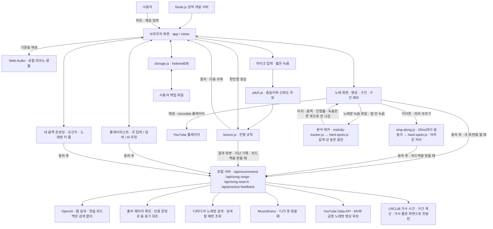
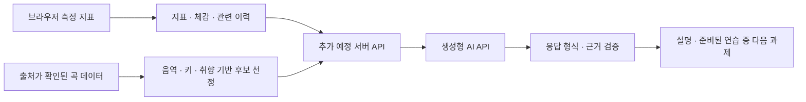

# SING 시스템 구조

처음 작성: 2026-10-13, 갱신: 2026-11-18(노래방 녹음 분석). 현재는 **모바일 웹 프로토타입**이며, 아래의 현재 구조와 확장 구조를 구분한다.

## 현재 구조

서버는 HTML·JavaScript·CSS·동봉 자산을 제공한다. 음높이 계산과 저장은 브라우저 안에서 수행하며, 음성 업로드 API와 회원 서버는 없다. 곡 추천(`POST /api/recommend`)과 최고음 찾기(`POST /api/song-range`)는 서버를 거쳐 OpenAI를 호출하고, 곡 검색(`GET /api/song-search`)은 서버가 TJ미디어 노래방 검색에 먼저 묻고(사용자가 검색할 때만, 결과는 쌓지 않음), 찾지 못하면 MusicBrainz에 묻는다. 노래 화면은 곡 상세 화면을 처음 열 때 영상 후보(`GET /api/song-videos`, YouTube Data API)와 구간(`GET /api/song-sections`, LRCLIB 가사 시간)을 서버에 묻는다. 서버는 구간 시간과 이름, 그리고 가사 줄을 돌려준다. 화면은 구간만 곡에 저장하고 가사 줄은 메모리에만 두어 화면에 보여준다(기기 저장소·백업·서버 디스크·로그에 남기지 않는다). 원곡은 YouTube 공식 음원 트랙("가수 - Topic")을 곡 길이로 맞춰 먼저 쓰고, 없으면 MV를 쓴다. 키는 서버의 `.env`에만 있고, 모두 사용자 동의(버전 5) 후에만 요청한다. 연습 피드백(`POST /api/practice-feedback`)은 앱이 잰 숫자만 서버를 거쳐 OpenAI로 보낸다(아래 ‘연습 피드백 데이터 흐름’). AI가 준 최고음은 서버가 출처 페이지를 열어 인용 문장과 음 표기를 대조한 뒤에만 앱으로 보낸다. 이때 사설·루프백 주소로는 접속하지 않는다.

| 구성 | 책임 | 주요 파일 |
| --- | --- | --- |
| 화면과 조정 | 화면 전환, 입력, 저장 호출, 체험/실제 상태 분리 | `src/app.js`, `src/views.js`, `src/styles.css` |
| 오디오 | 피아노 샘플 선택·재생, 마이크 요청, 녹음, 취소 처리 | `src/piano.js`, `src/audio.js`, `src/capture.js` |
| 음높이 분석 | 단일 음의 주기성에서 주파수·음이름·신뢰도 요약 | `src/pitch.js` |
| 레슨 규칙 | 시작음 확인, 목표음 비교, 체감에 따른 진행·종료 | `src/lesson.js` |
| 곡과 플레이리스트 | 곡 검증, 제목·가수 검색, 키 변경 표시, 사용자 이름 플레이리스트와 AI 추천 | `src/songs.js`, `src/song-views.js`, `src/playlists.js`, `src/playlist-views.js`, `src/recommend.js` |
| 내 음역 | 자신 있는 곡으로 편한 최고음 어림, 남녀 곡 옥타브 제안, 편함·도전·무리 분류, 오선지와 노래방 키 줄(원키 가운데, 맞는 키 표시) | `src/onboarding.js`, `src/onboarding-views.js`, `src/vocal-range.js`, `src/notes.js`, `src/range-graphics.js` |
| AI와 외부 연결 | 추천·최고음 찾기 흐름, 출처 확인, 곡 검색(TJ 우선, MusicBrainz 대체), 요청 간격, 동의 버전 | `scripts/services.mjs`, `scripts/ai.mjs`, `scripts/verify-source.mjs`, `scripts/song-search.mjs`, `scripts/tj.mjs`, `scripts/throttle.mjs`, `scripts/musicbrainz.mjs`, `src/consent.js` |
| 노래 화면 | 원곡(음원 트랙, 없으면 MV)·금영 노래방 영상 재생(플레이어를 지운 채 다시 그리지 않음), 자동 구간과 흐름 막대, 영상별 시작 맞추기, 구간 메모, 영상 바꾸기·링크 붙여넣기 | `src/song-media.js`, `src/song-media-views.js`, `src/song-player.js`, `src/sections.js`, `scripts/youtube.mjs`, `scripts/lrclib.mjs`, `scripts/title-match.mjs` |
| 노래방 녹음 분석 | 녹음 파일 읽기(50MB·10분 한도, 16kHz 모노), 반주 속 가수의 음 따라가기(실험에서 고른 값, 20ms마다), 길게 낸 높은 음과 부른 음역·편한 최고음 제안, 첫 소리 시간, 화면과 따로 도는 워커와 진행률, 앱 안 녹음(AudioWorklet, 화면 켜 두기, `?record`일 때만) | `src/karaoke-file.js`, `src/resample.js`, `src/melody-tracker.js`, `src/karaoke-analysis.js`, `src/analysis-worker.js`, `src/analysis-client.js`, `src/karaoke-recorder.js`, `src/pcm-worklet.js` |
| 저장 | 상태/원음 저장, 백업 검증과 복원 | `src/storage.js` |
| 개발 서버 | 허용된 정적 파일 제공과 API 전달(입력 한도, 키는 `.env`) | `scripts/serve.mjs`, `scripts/server.mjs` |
| 접근 관리 (배포) | 초대 코드, 기기별 요청 간격(코드가 없는 요청은 접속 주소별, 틀린 코드 잠금도 주소별), 기기별·전체 하루 한도, 날짜별 기기 수(메모리), 초대 코드 없이 바깥에 열리면 켜지지 않기 | `scripts/access.mjs` |
| 영상 찾기 보관 | 찾은 영상을 일주일 동안 메모리에 두어 같은 곡을 다시 검색하지 않음 | `scripts/video-cache.mjs` |
| 요청 한 곳 | 모든 API 요청에 기기 번호와 초대 코드를 붙이고, 초대 거절·하루 한도·잠든 서버를 앱에 알림 | `src/api.js` |
| 휴대폰 환경 | 앱 안 브라우저(카카오톡) 알아보기, 플랫폼, 홈 화면 실행 여부, 뒤로 가기 덫, 홈 카드(설문·홈 화면 추가·백업) | `src/environment.js`, `src/back.js`, `src/nudges.js` |
| 화면 파일 보관 | 앱 파일을 휴대폰에 두고, 서버가 3초 안에 답하면 새 파일로 바꿈(API는 거치지 않음). 서버가 화면과 스크립트의 모듈 주소에 내용 해시(`?v=`)를 붙이고 다른 버전 주소는 거절해서, 배포 직후에도 한 번 여는 동안 옛 파일과 새 파일이 섞이지 않음. 새 화면을 쓰기 시작하면 다른 버전 파일을 지움 | `sw.js`, `manifest.webmanifest`, `scripts/server.mjs` |

### 배포했을 때 (2026-11-17)

같은 Node 서버 하나가 Render 무료 웹 서비스(싱가포르)에서 돈다(`render.yaml`). 모든 `/api/` 요청은 경로를 고르기 전에 `access.check()`를 지난다. 열려 있는 것은 `/api/health`(호스트의 상태 확인)와 `/api/config`(초대가 필요한지, 설문 주소)뿐이다. 초대 코드는 `#invite=` 링크로 들어와 `localStorage`의 `sing.invite`에 저장되고, 요청마다 `X-Sing-Invite` 헤더로 간다. 기기 번호(`crypto.randomUUID()`)는 `sing.device`에 저장되어 `X-Sing-Device`로 간다. 서버에는 디스크가 없어서 한도와 기기 수는 메모리에만 있고 재시작하면 0이 된다. 서비스 워커는 HTTPS에서만 등록한다.

## 화면 보안 설정 (CSP)

- 기본은 `'self'`만 허용한다. 노래 화면의 플레이어 때문에 `script-src`에 `https://www.youtube.com`(IFrame API), `frame-src`에 `https://www.youtube-nocookie.com`만 더했다.
- `style-src`는 `'self'`뿐이라 화면 문자열에 인라인 스타일을 쓰지 않는다. 흐름 막대 같은 위치는 SVG 속성으로 정한다.
- `Referrer-Policy`는 두지 않는다. YouTube는 페이지 주소를 받지 못하면 퍼간 영상을 재생하지 않는다(오류 153).

## 연습 피드백 데이터 흐름

측정은 앱이, 설명은 AI가 한다. AI는 녹음이나 가사 글자를 받지 않는다.

1. 허밍: 결과 화면이나 지난 기록에서 ‘AI 피드백 받기’를 누르면 시도별 목표음·낸 음(한국식 음 이름)·목표음과의 차이(센트)·체감·측정 결과, 편하게 확인한 음, 오늘·지난번 최고음, 내 편한 최고음, 통증 중단 여부를 `POST /api/practice-feedback`으로 보낸다.
2. 따라 부르기: 노래 화면에서 이어폰을 끼고 부르는 동안 25ms마다 마이크 음높이(선명도 0.85 이상만)를 곡 시간과 함께 메모리에 모은다. 멈추면 `hard-spots.js`가 음을 묶고 어려운 자리(큰 도약, 길게 낸 높은 음, 편한 최고음보다 높은 음)와 결과(지켰다·내려왔다·끊김은 묻기)를 많아야 3곳 고른다. `exercises.js`가 자리 종류에 맞는 연습을 고른다. 리포트는 `spot-words.js`의 앱 문장으로 바로 뜬다. 동의가 있으면 자리의 종류·결과·음 이름·구간 이름과 곡 제목·가수만 서버로 보낸다(시간·가사 줄 번호·가사 글자·녹음은 보내지 않음).
3. 서버는 요청 형식(키·개수·음 이름 형식·범위)을 확인한다. 허밍은 지금처럼 숫자와 기준을 넘긴다. 따라 부르기는 자리마다 한 문장을 받는다(웹 검색 없음, JSON 스키마 `spot_words`). 옛 줄 단위 요청(`kind: song`)은 400으로 거절한다.
4. 서버는 답에서 허밍은 항목마다 80자 이내, 목록마다 2개까지만 남긴다. 따라 부르기는 자리마다 AI 문장을 검사해, 빠진 자리나 받지 않은 음 이름·시간·숫자·따옴표가 있는 문장, 끊김을 단정하거나(물음이 아님) 다른 자리에 물음표를 쓴 문장은 앱의 문장으로 바꾼다. 브라우저도 같은 검사를 한 번 더 한다.
5. 허밍 피드백은 그 레슨에 함께 저장한다(백업에도 포함). 따라 부르기 리포트는 화면에만 보여주고 저장하지 않으며, 가사 줄 글자는 기기 메모리의 가사에서 붙인다(가사가 없으면 시간). 화면을 떠나면 사라진다.

## 노래방 녹음 데이터 흐름

녹음은 폰을 떠나지 않고 저장하지 않는다. 분석 경로의 파일에는 네트워크·저장소 코드(`fetch`, `XMLHttpRequest`, `WebSocket`, `sendBeacon`, `indexedDB`, `localStorage`)가 없고, `tests/app-source.test.mjs`가 이를 확인한다.

1. 노래 화면에서 파일을 고르면 `karaoke-file.js`가 크기(50MB)를 보고, 브라우저의 `decodeAudioData`로 풀어 길이(10분)를 본 뒤 `resample.js`로 16kHz 모노를 만든다. 앱 안 녹음(`?record`)은 `pcm-worklet.js`가 마이크 소리를 4096표본씩 넘기고 `karaoke-recorder.js`가 메모리에 모은다(30초 미만은 버림, 10분에서 멈춤, 화면이 꺼지면 멈추고 거기까지 분석).
2. `analysis-client.js`가 소리의 복사본을 모듈 워커(`analysis-worker.js`)로 넘기고 진행률을 받는다. 화면을 떠나면 워커를 끝낸다.
3. 워커 안에서 `melody-tracker.js`가 20ms마다 가장 가수다운 음을 고른다(배음 모으기 → 자연스럽게 이어지는 길 → 건반 음에 딱 맞고 움직이지 않는 반주의 음 버리기). `hard-spots.js`의 `findSpots(…, { source: 'karaoke' })`가 길게 낸 높은 음만 자리로 고르고, `karaoke-analysis.js`가 부른 음역(가장 높게 길게 낸 음, 길게 지킨 음)과 편한 최고음 제안(4반음 안쪽), 첫 소리 시간을 더한다.
4. 리포트는 앱의 문장으로 바로 뜬다. 동의가 있으면 따라 부르기와 같은 `POST /api/practice-feedback`(자리의 종류·결과·음 이름)으로 문장만 다듬는다. 녹음·시간·가사는 보내지 않는다.
5. ‘내 녹음 듣기’는 메모리의 소리에서 그 자리 3초 앞부터 8초를 튼다. 첫 소절을 확인하면 그 차이(숫자 하나)만 기억하고, 가사 줄 글자는 그릴 때 메모리의 가사에서 붙인다. 곡 화면을 떠나면 소리와 리포트가 모두 사라진다.

## 한 번의 연습 데이터 흐름

1. 첫 시도는 편한 높이에서 허밍한다. 이후 목표음이 정해지면 피아노를 듣고 짧게 따라 한다.
2. 마이크 입력을 짧은 프레임으로 나눠 분석한다. 신호가 부족하거나 음높이 변화가 큰 시도는 미확인으로 처리한다.
3. 측정값과 별도로 사용자가 편안함·힘듦·모름·불편함을 입력한다.
4. 레슨 규칙이 같은 음 재확인, 종료, 선택적 반음 상승 여부를 결정한다. 측정 실패를 임의의 성공값으로 바꾸지 않는다.
5. 확인한 음, 시도별 결과와 체감을 저장한다. 사용자가 원음 보관을 선택했을 때만 녹음도 저장한다.

분석 결과는 해당 시도의 음높이 정보다. 전체 음역이나 발성 원인을 확정하는 결과가 아니다.

## 저장 구조

- IndexedDB `sing-practice`의 `state`와 `recordings`를 사용한다.
- 상태에는 완료 레슨, 진행 중 초안, 학습/휴식 활동, 개인 곡, 원음 보관 설정이 포함된다.
- 곡에는 선택 필드 `media`가 붙을 수 있다: MV·노래방 영상(자동으로 찾은 것은 후보 3개까지, 30일 뒤 지우고 다시 찾음), 찾지 못한 기록("없음", 7일), 구간 시간과 이름, 영상별 시작 차이, 구간 메모(영상 ID와 그 영상의 시간). 가사 글자는 저장하지 않는다. 곡 제목이나 가수를 고치면 자동으로 찾은 영상과 구간만 지운다.
- 백업 파일은 상태와 선택적으로 보관한 원음을 함께 담는다. 복원 전 형식·용량을 검증한다.
- 체험 모드는 메모리 안에서 동작하며 실제 저장소에 예시 결과를 쓰지 않는다.
- 브라우저·기기·접속 주소가 달라지면 저장소도 달라진다. 현재 계정과 기기 간 동기화는 없다.

## 확장 구조 — 계획

연습 피드백은 위 흐름으로 구현했다. 아래는 그 밖의 계획이다. 서버·모델·곡 데이터 공급원은 미정이다. 서버에서 API 키를 관리하고, 초기 AI 입력은 원음보다 측정 지표를 중심으로 설계할 계획이다. 전송 범위 안내와 동의, 실패 시 기본 피드백은 연결 단계에서 구현한다. 아직 존재하는 서비스로 해석하면 안 된다.

관련 문서: [AI 활용 계획](ai-plan.md) · [로드맵](roadmap.md)
