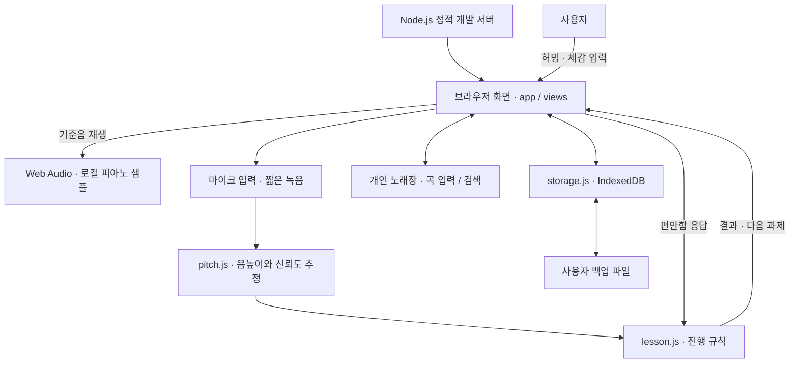
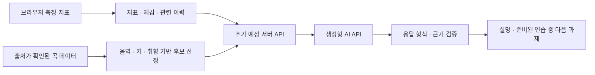

# SING 시스템 구조

기준일: 2026-10-13. 현재는 **1단계 모바일 웹 프로토타입**이며, 아래의 현재 구조와 확장 구조를 구분한다.

## 현재 구조

서버는 HTML·JavaScript·CSS·동봉 자산을 제공한다. 음높이 계산과 저장은 브라우저 안에서 수행하며, 현재 음성 업로드 API·회원 서버·생성형 AI 호출은 없다.

| 구성 | 책임 | 주요 파일 |
| --- | --- | --- |
| 화면과 조정 | 화면 전환, 입력, 저장 호출, 체험/실제 상태 분리 | `src/app.js`, `src/views.js`, `src/styles.css` |
| 오디오 | 피아노 샘플 선택·재생, 마이크 요청, 녹음, 취소 처리 | `src/piano.js`, `src/audio.js`, `src/capture.js` |
| 음높이 분석 | 단일 음의 주기성에서 주파수·음이름·신뢰도 요약 | `src/pitch.js` |
| 레슨 규칙 | 시작음 확인, 목표음 비교, 체감에 따른 진행·종료 | `src/lesson.js` |
| 개인 노래장 | 곡 검증, 제목·가수 검색, 상태 필터, 키 변경 표시 | `src/songs.js`, `src/song-views.js` |
| 저장 | 상태/원음 저장, 백업 검증과 복원 | `src/storage.js` |
| 개발 서버 | 허용된 정적 파일 제공 | `scripts/serve.mjs` |

## 한 번의 연습 데이터 흐름

1. 첫 시도는 편한 높이에서 허밍한다. 이후 목표음이 정해지면 피아노를 듣고 짧게 따라 한다.
2. 마이크 입력을 짧은 프레임으로 나눠 분석한다. 신호가 부족하거나 음높이 변화가 큰 시도는 미확인으로 처리한다.
3. 측정값과 별도로 사용자가 편안함·힘듦·모름·불편함을 입력한다.
4. 레슨 규칙이 같은 음 재확인, 종료, 선택적 반음 상승 여부를 결정한다. 측정 실패를 임의의 성공값으로 바꾸지 않는다.
5. 확인한 음, 시도별 결과와 체감을 저장한다. 사용자가 원음 보관을 선택했을 때만 녹음도 저장한다.

분석 결과는 해당 시도의 음높이 정보다. 전체 음역이나 발성 원인을 확정하는 결과가 아니다.

## 저장 구조

- IndexedDB `sing-practice`의 `state`와 `recordings`를 사용한다.
- 상태에는 완료 레슨, 진행 중 초안, 학습/휴식 활동, 개인 곡, 원음 보관 설정이 포함된다.
- 백업 파일은 상태와 선택적으로 보관한 원음을 함께 담는다. 복원 전 형식·용량을 검증한다.
- 체험 모드는 메모리 안에서 동작하며 실제 저장소에 예시 결과를 쓰지 않는다.
- 브라우저·기기·접속 주소가 달라지면 저장소도 달라진다. 현재 계정과 기기 간 동기화는 없다.

## 확장 구조 — 계획

서버·모델·곡 데이터 공급원은 미정이다. 서버에서 API 키를 관리하고, 초기 AI 입력은 원음보다 측정 지표를 중심으로 설계할 계획이다. 전송 범위 안내와 동의, 실패 시 기본 피드백은 연결 단계에서 구현한다. 아직 존재하는 서비스로 해석하면 안 된다.

관련 문서: [AI 활용 계획](ai-plan.md) · [로드맵](roadmap.md)
