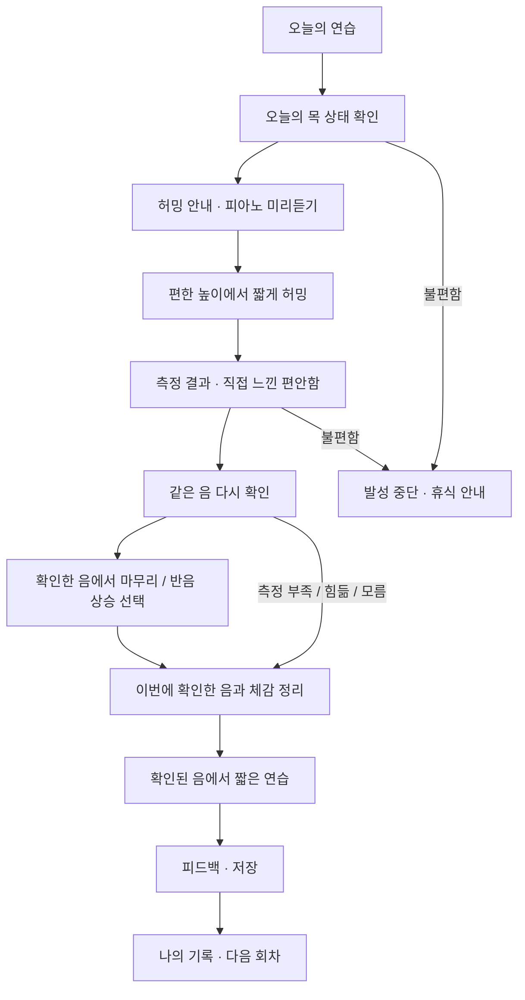

# 화면과 사용자 흐름

기준일: 2026-10-13. 스크린샷은 2026-09-27~28 구현을 확인하면서 남긴 자료다. 홈은 초기 구현 화면이고, 개인 노래장은 곡을 추가하기 전 상태다.

## 현재 화면

| 오늘의 연습 | 개인 노래장 |
| --- | --- |
|  |  |

[데스크톱 화면](screenshots/home-desktop.png)

## 첫 레슨

후속 발성 과제는 반복해서 편하게 확인한 음이 있고 중단 조건에 해당하지 않을 때만 제안한다. 모든 사용자가 같은 단계까지 진행하는 것은 아니다. 미확인 결과도 사실대로 보여주며 재시도와 종료를 허용한다.

| 단계 | 사용자의 행동 | 앱이 보여주는 것 |
| --- | --- | --- |
| 안내 | 목 상태를 선택하고 허밍 설명을 읽는다 | 입술·턱에 대한 간단한 안내, 기준음 미리듣기 |
| 탐색 | 짧게 허밍하고 체감을 선택한다 | 확인한 음 또는 미확인 이유 |
| 재확인 | 같은 음을 다시 내본다 | 반복 확인 여부, 마무리/다음 시도 선택 |
| 연습 | 확인된 음으로 짧게 따라 한다 | 측정 결과와 사용자 체감 |
| 기록 | 저장하고 이전 회차를 확인한다 | 시도별 기록과 주간 활동 |

음높이 숫자를 올리는 것보다 편안함을 확인하고 연습을 이어가는 경험을 우선한다. 결과에서 이번 시도의 확인 음을 사용자의 전체 음역으로 단정하지 않는다.

## ‘뭐 부르지?’

현재는 `곡 추가 → 제목·선택 정보 입력 → 저장 → 검색/상태별 확인 → 수정 또는 삭제` 흐름의 개인 노래장이다.

현재 상태는 **불러볼 곡 / 연습 중 / 익숙한 곡**이다. 제목만 입력해도 저장할 수 있으며 원곡 키, 음역, 개인 키 조정, 가사 링크, 메모를 선택적으로 남긴다. 입력하지 않은 원곡 음역은 자동으로 채우지 않는다.

다음 확장에서는 **자신 있는 곡 / 도전! 곡 / 불러보고 싶은 곡** 분류와 별도의 연습 중 표시를 검토한다. 곡 추천은 데이터 확보와 실제 경험 기록을 바탕으로 추가할 계획이다.

## 시연 시나리오 초안

사용자: 집에서 혼자 연습하려는 보컬 초보자. 하고 싶은 일: 오늘 편한 시작음을 확인하고 다음에 할 짧은 연습을 찾기.

| 순서 | 보여줄 장면 | 전달할 내용 |
| --- | --- | --- |
| 1 | 홈과 허밍 안내 | 초보자도 짧은 안내로 시작한다 |
| 2 | 피아노 기준음과 한 번의 허밍 | 내장 마이크로 음높이를 확인한다 |
| 3 | 결과와 편안함 입력 | 측정값과 사용자 체감을 함께 본다 |
| 4 | 후속 연습과 기록 | 한 번 측정하고 끝나지 않고 다음 연습으로 이어진다 |
| 5 | 개인 노래장 | 실제로 부를 곡과 개인 키를 관리한다 |

30초 시연은 1~4번 핵심 장면을 미리 준비한 녹화로 압축하는 안이다. 체험 모드를 사용하면 예시 데이터임을 표시한다. 실제 마이크 시연의 가능 여부는 Android 실기기 검증 후 결정한다. 향후 AI 기능은 구현 전까지 계획으로 소개한다.
