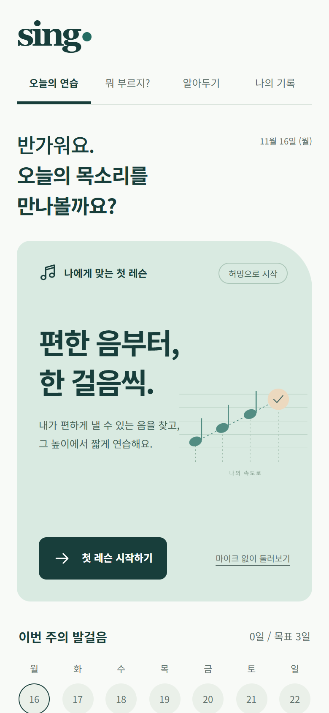
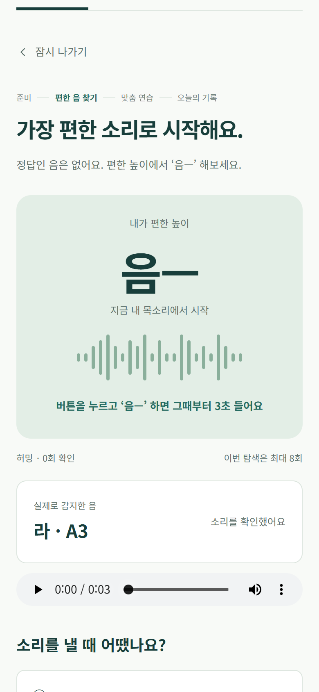
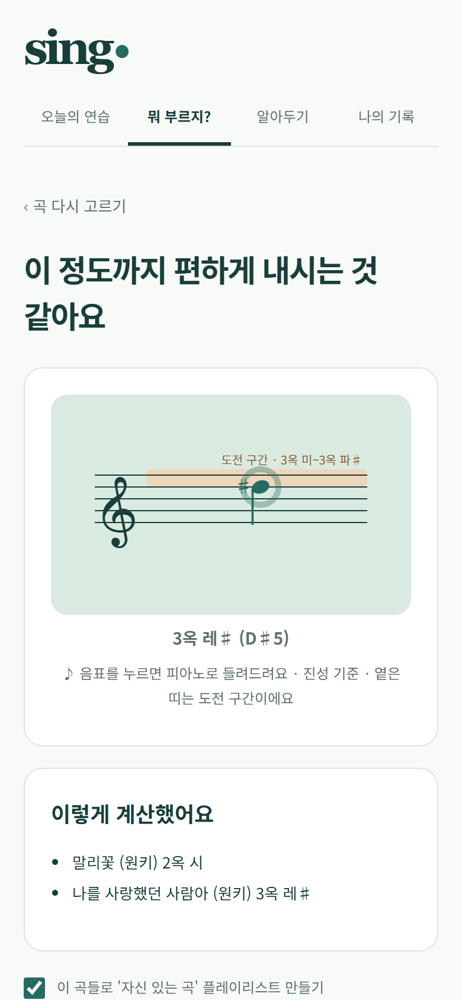
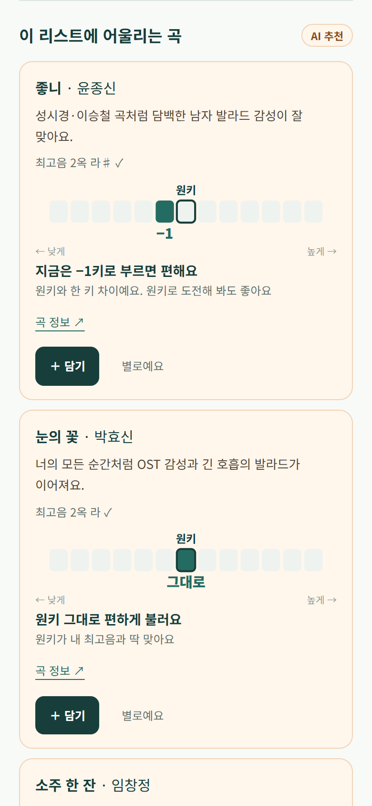
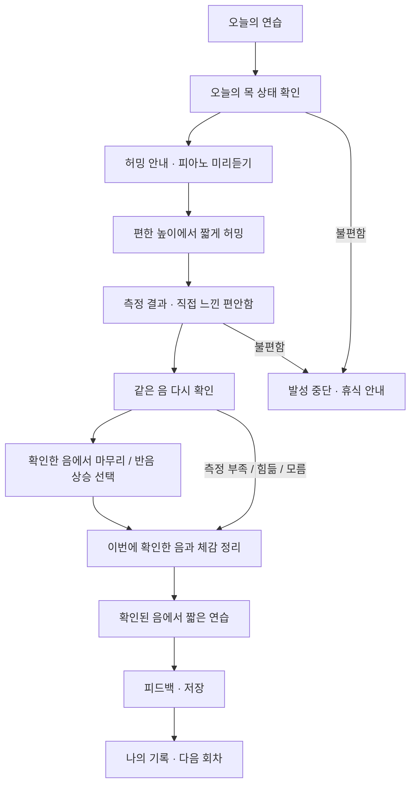
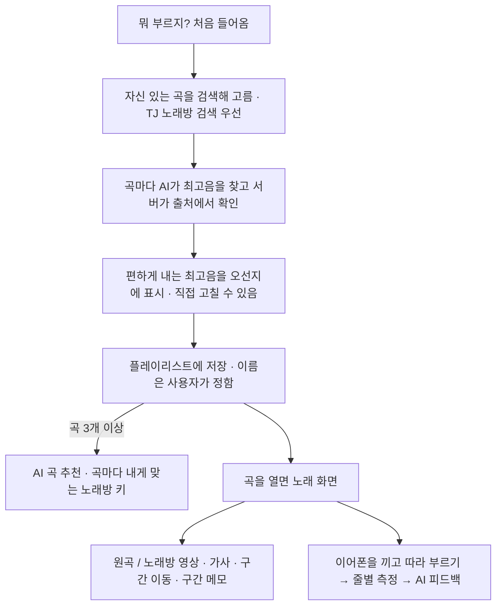

# 화면과 사용자 흐름

처음 작성: 2026-10-13, 갱신: 2026-11-16. 화면은 2026-11-16에 실제 앱을 휴대폰 크기(390×844)로 띄워 찍었다. 마이크에는 테스트용 합성 음성을 넣었고, AI 응답과 곡 정보는 실제 응답이다.

## 현재 화면

| 오늘의 연습 | 허밍 측정 | 내 음역 | AI 곡 추천 |
| --- | --- | --- | --- |
|  |  |  |  |

노래 화면은 가사가 보여서 화면을 싣지 않았다. 9월의 초기 화면: [홈](screenshots/home-mobile.png) · [개인 노래장](screenshots/songbook-mobile.png) · [데스크톱](screenshots/home-desktop.png)

## 첫 레슨

후속 발성 과제는 반복해서 편하게 확인한 음이 있고 중단 조건에 해당하지 않을 때만 제안한다. 모든 사용자가 같은 단계까지 진행하는 것은 아니다. 미확인 결과도 사실대로 보여주며 재시도와 종료를 허용한다.

| 단계 | 사용자의 행동 | 앱이 보여주는 것 |
| --- | --- | --- |
| 안내 | 목 상태를 선택하고 허밍 설명을 읽는다 | 입술·턱에 대한 간단한 안내, 기준음 미리듣기 |
| 탐색 | 짧게 허밍하고 체감을 선택한다 | 확인한 음 또는 미확인 이유 |
| 재확인 | 같은 음을 다시 내본다 | 반복 확인 여부, 마무리/다음 시도 선택 |
| 연습 | 확인된 음으로 짧게 따라 한다 | 측정 결과와 사용자 체감 |
| 기록 | 저장하고 이전 회차를 확인한다 | 시도별 기록과 주간 활동 |

음높이 숫자를 올리는 것보다 편안함을 확인하고 연습을 이어가는 경험을 우선한다. 결과에서 이번 시도의 확인 음을 사용자의 전체 음역으로 단정하지 않는다.

## ‘뭐 부르지?’

9월의 개인 노래장(불러볼 곡 / 연습 중 / 익숙한 곡)은 11월에 사용자가 이름을 붙이는 **플레이리스트**로 바뀌었다. 지금의 흐름은 다음과 같다.

곡은 검색해서 담고, 찾지 못한 곡만 직접 입력한다. 출처에서 확인하지 못한 최고음은 채우지 않는다. AI를 쓰는 기능은 처음 쓸 때 무엇을 보내는지 보여 주고 동의를 받는다.

## 시연 시나리오 초안

사용자: 집에서 혼자 연습하려는 보컬 초보자. 하고 싶은 일: 오늘 편한 시작음을 확인하고 다음에 할 짧은 연습을 찾기.

| 순서 | 보여줄 장면 | 전달할 내용 |
| --- | --- | --- |
| 1 | 홈과 허밍 안내 | 초보자도 짧은 안내로 시작한다 |
| 2 | 피아노 기준음과 한 번의 허밍 | 내장 마이크로 음높이를 확인한다 |
| 3 | 결과와 편안함 입력 | 측정값과 사용자 체감을 함께 본다 |
| 4 | 후속 연습과 기록 | 한 번 측정하고 끝나지 않고 다음 연습으로 이어진다 |
| 5 | 뭐 부르지? | 내 음역을 찾고, AI 추천 곡과 맞는 노래방 키를 본다 |
| 6 | 노래 화면과 따라 부르기 | 구간으로 이동하고, 따라 부른 뒤 어느 줄이 아쉬웠는지 본다 |

2026년 11월 17일 발표의 30초 시연은 이 순서를 녹화한 영상이다. 마이크에는 테스트용 합성 음성을 넣었고 영상에 그 사실을 적었다. 앱 화면과 AI 응답은 실제 동작이다.
